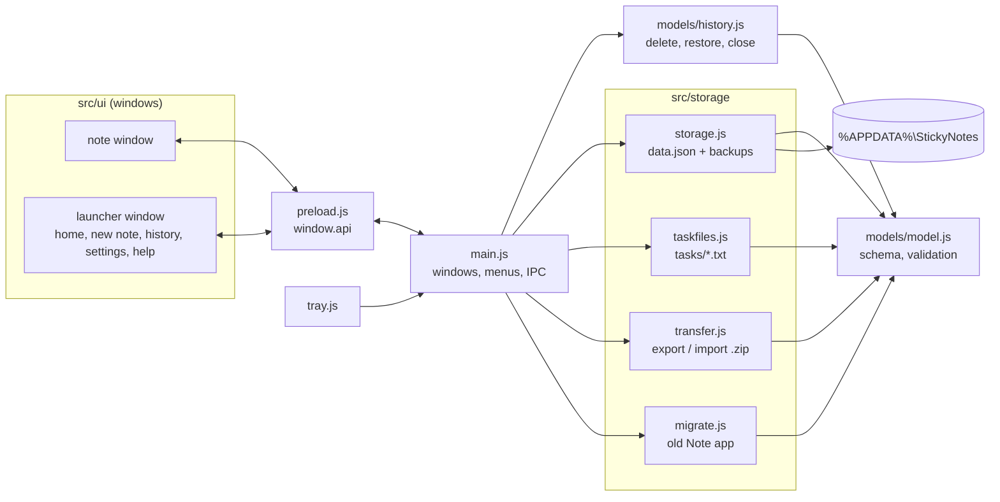

# Project map

Sticky Notes is an Electron app: one main process (Node) and small HTML windows. No UI framework, no bundler.

## Flow

The main process owns the data. Windows send changes through `window.api`; the main process validates
them (`model.js`), saves (`storage.js`), and tells the tray and launcher to refresh.

## Folders

| Folder | What is in it |
| --- | --- |
| `src/main/` | Main process: app start, windows, menus, IPC, tray, desktop pinning, generated icons |
| `src/models/` | The data shape (`schema_version` 2), validation, upgrade from older files, History rules. No disk, no windows |
| `src/storage/` | Everything that touches the disk: data file, backups, task `.txt` files, export/import, migration |
| `src/ui/note/` | The note window (task list) |
| `src/ui/launcher/` | The launcher window: note list, new note, history, help |
| `tests/` | Plain Node test scripts, one per module; `tests/e2e/` drives the real app |
| `assets/` | Fonts (Caveat, Inter; latin and latin-ext) and README screenshots |
| `build/` | `icon.png` and `splash.bmp`, generated by `npm run icon` |
| `.github/workflows/` | `ci.yml` runs the tests; `release.yml` builds both .exe files for a version tag |

## Key files

| File | Role |
| --- | --- |
| `src/main/main.js` | Entry point. Data folder paths, note windows, settings, global shortcuts, export/import dialogs, IPC handlers |
| `src/main/preload.js` | The only bridge between windows and the main process (`window.api`) |
| `src/main/pinning.js` | Win32 calls (through `koffi`) that stick a note to the desktop |
| `src/models/model.js` | `upgrade()` turns any older or damaged file into valid current data |
| `src/models/history.js` | What deleting, clearing, closing, restoring and deleting for good do to the data |
| `src/storage/storage.js` | Atomic save (temp file, then rename), `.bak`, 5 rotated backups, recovery on load |
| `src/storage/taskfiles.js` | One `.txt` per task: create, rename with the task, delete with the task |
| `src/storage/transfer.js` | Backup `.zip`: export, validate, merge or replace; daily zip of the task files |
| `src/storage/migrate.js` | First-start copy from `%APPDATA%\Note` (read-only on the old folder) |
| `src/ui/note/note.js` | Task editing, reorder, undo stack, keyboard shortcuts |
| `src/ui/launcher/launcher.js` | Views of the launcher, search and date filter, settings |

## Data on disk (`%APPDATA%\StickyNotes`)

`data.json` (notes, history, settings) · `data.json.bak` (an earlier save) · `backups\` (last 5 of data and of task files) · `tasks\` (one `.txt` per task).
Chromium caches go to `%LOCALAPPDATA%\StickyNotes`.

## Commands

| Command | What it does |
| --- | --- |
| `npm install` | Install Electron and the two runtime dependencies |
| `npm start` | Run from source (uses your real notes folder) |
| `set STICKYNOTES_DATA_DIR=C:\temp\sn && npm start` | Run on a throwaway data folder |
| `npm test` | Unit tests |
| `npm run test:e2e` | Start the real app on a temp folder and click through it |
| `build.bat` | Test, then build `dist\StickyNotes.exe` (portable) and `dist\StickyNotes-Setup.exe` (installer) |
