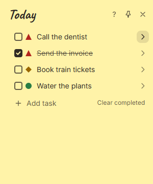
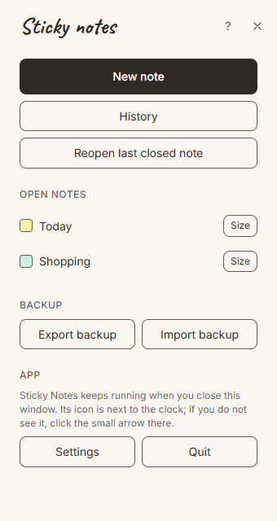
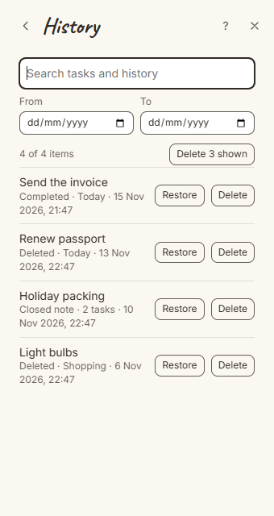
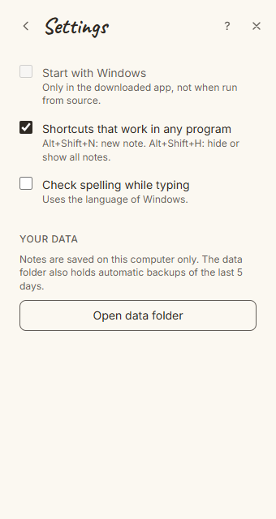

# Sticky Notes

Small sticky notes with task lists for your Windows desktop. Everything stays on your computer: no account, no internet.

 

## Download

1. Open the [Releases page](../../releases/latest).
2. Download one of the two files:
   - **StickyNotes-Setup.exe** (recommended). Installs the app. It opens in about 2 seconds and gets a Start menu entry.
   - **StickyNotes.exe**. Nothing to install: double-click it and it runs. It takes about 10 seconds to open each time.
3. Double-click the file you downloaded.

Both work on Windows 10 and 11, need no administrator rights, and use the same notes.

## "Windows protected your PC"

Windows shows this blue box the first time you open the file.

1. Click **More info**.
2. Click **Run anyway**.

Why it happens: Windows shows this for every program that has no paid certificate ("is not signed"). This app has none. The file is built from the code in this repository.

## How to use it

1. Click **New note**, pick a size and a colour, click **Create note**.
2. Type a task and press **Enter**. Type the next one.
3. Click the box in front of a task to tick it off.
4. Click the shape to set the priority: ▲ High, ◆ Medium, ● Low.
5. Click the arrow at the end of a task to open a text file for longer notes about it.

Closing a note or deleting a task does not lose it. It goes to **History**, where you can search, restore, or delete it for good.

The app keeps running when you close its window. Its icon sits next to the clock (click the small arrow there if you do not see it). Right-click the icon for the menu. **Quit** stops the app.

 

## Keyboard shortcuts

| Keys | What they do |
| --- | --- |
| `Ctrl` + `N` | New task (in the main window: new note) |
| `Ctrl` + `F` | Search tasks and history |
| `Ctrl` + `Z` | Undo the last change |
| `Del` | Delete the selected task |
| `Tab` | Select the next task |
| `Space` | Tick the selected task |
| `Enter` | Change the selected task. While typing: save and start the next task |
| `Alt` + `↑` / `↓` | Move the selected task up or down |
| `Esc` | Cancel typing, or go back |
| `F1` | Help |
| `Alt` + `Shift` + `N` | New note, from any program |
| `Alt` + `Shift` + `H` | Hide or show all notes, from any program |

The last two can be turned off in **Settings**.

## Where your notes are

Your notes are in one folder: `%APPDATA%\StickyNotes`. To open it, click **Settings**, then **Open data folder**.

| In that folder | What it is |
| --- | --- |
| `data.json` | All notes, tasks, history and settings |
| `tasks\` | The text files you opened with the arrow, one per task |
| `backups\` | Automatic backups of the last 5 days |

### Make a backup (export)

1. Open the main window (click the icon next to the clock).
2. Click **Export backup**.
3. Choose where to save the file. It is called something like `StickyNotes-backup-2026-11-15.zip`.

That one file holds everything.

### Load a backup (import)

1. Click **Import backup** and pick the file.
2. The app shows what is inside, for example "3 notes, 12 tasks and 30 history items".
3. Choose:
   - **Merge** adds what you do not have yet. Nothing you have now changes.
   - **Replace** swaps everything you have now for the backup.

The app saves a backup of your current notes before every import. A wrong or damaged file is refused with a message; nothing changes.

## Questions

**How do I move my notes to a new PC?**
1. On the old PC: **Export backup**. Copy the file to the new PC (USB stick, email, cloud drive).
2. On the new PC: start Sticky Notes, click **Import backup**, choose **Replace**.

**How do I make it start with Windows?**
Click **Settings** and tick **Start with Windows**. If you use `StickyNotes.exe` (no install) and later move that file, tick it again.

**How do I uninstall it?**
- Installed with the Setup file: open Windows **Settings → Apps**, find Sticky Notes, click **Uninstall**.
- `StickyNotes.exe`: untick **Start with Windows** in Settings, click **Quit**, delete the file.

Your notes stay on the computer after both.

**How do I delete all my notes and data?**
1. Quit the app.
2. Press `Win` + `R`, type `%APPDATA%`, press Enter. Delete the `StickyNotes` folder.
3. Press `Win` + `R`, type `%LOCALAPPDATA%`, press Enter. Delete the `StickyNotes` folder there too (it only holds temporary files).

**I deleted something by mistake.**
Press `Ctrl` + `Z` straight away, or open **History** and click **Restore**.

**Does it send my notes anywhere?**
No. The app never goes online.

**How do I update?**
Download the newer file from the Releases page and open it. Your notes are kept.

**I used the older "Note" app.**
The first time Sticky Notes starts, it copies your notes from Note. Nothing in the old app is changed. Check your notes, then uninstall Note: the two apps do not share notes.

## For developers

Electron, plain HTML/CSS/JS, two runtime dependencies (`adm-zip`, `koffi`). See [PROJECT_MAP.md](PROJECT_MAP.md) for the layout.

Needs Windows and [Node.js](https://nodejs.org) 22.12 or newer.

```
npm install
npm start            run from source (uses your real notes folder)
npm test             unit tests
npm run test:e2e     starts the real app on a temporary folder and clicks through it
build.bat            tests, then builds dist\StickyNotes.exe and dist\StickyNotes-Setup.exe
```

To try things without touching your own notes:

```
set STICKYNOTES_DATA_DIR=C:\temp\stickynotes-dev
npm start
```

Releases: push a tag such as `v1.0.1` and the `Release` workflow builds both files and attaches them to a GitHub Release.

## License

MIT, see [LICENSE](LICENSE). Fonts: Caveat and Inter, SIL Open Font License 1.1 (`assets/fonts/OFL-*.txt`).
